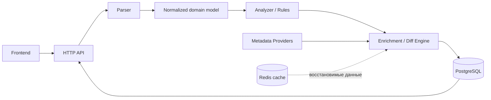

# Архитектура v0.1

Документ фиксирует принятый для проектирования baseline. Он не описывает реализованную систему и не задаёт точную схему данных.

## Назначение и границы

Сервис анализирует предоставленный план обновления Gentoo и объясняет, что будет обновлено, какие различия между версиями удалось установить и какие выводы требуют внимания. Выводы сопровождаются evidence и ограничениями исходных данных.

Первая версия не изменяет систему пользователя и не запускает `emerge`. Подтверждение анализа не запускает обновление.

## Принятые решения

### Backend и поток данных

Используется один backend без микросервисов. Предпочтительное направление для backend — Go; язык и структура кода ещё не закреплены как реализованный стек. Логические модули: HTTP layer, Domain, Parser, Analyzer / Rules, Diff Engine, Metadata Providers, Storage и Cache. Gentoo-specific логика отделена от HTTP и UI.

Frontend получает подготовленные backend результаты и не выполняет анализ самостоятельно.

### Parser и domain

Parser извлекает из поддерживаемого входа факты: пакет, версии, операцию, USE, SLOT и другие присутствующие данные. Parser не определяет severity, безопасность обновления или рекомендации. Неполный или неподдерживаемый вход должен приводить к явному ограничению результата, а не к выдуманным значениям.

Для предметной области предварительно выделены сущности:

- `Analysis` — результат анализа входного плана.
- `PackageChange` — конкретное изменение пакета.
- `Finding` — результат применения правила.
- `ChangeReport` — сведения о различиях между версиями пакета.
- `Rule` — правило анализа.

Поля, связи, обязательность, хранение evidence и статусы не согласованы. Эти названия не являются готовой схемой.

### Analyzer и результаты

Analyzer применяет детерминированные правила к нормализованным данным. Возможные коды findings: `BLOCKER_PRESENT`, `USE_CHANGED`, `SLOT_CHANGED`, `DEPENDENCY_CHANGED`, `LOCAL_PATCHED_PACKAGE`.

Предварительные UI-категории: `BLOCKER`, `SECURITY`, `CONFLICT`, `REVIEW`, `NORMAL`. Само изменение USE не доказывает наличие проблемы. Каждый finding содержит основание вывода и ссылку на evidence: входной фрагмент, пользовательские данные или metadata источника. Недостаток данных обозначается явно и не считается подтверждением проблемы. AI не является источником истины и не входит в критический путь принятия решения.

### Сравнение версий и данные

`ChangeReport` разделяет три направления сравнения:

1. **Gentoo / Portage metadata:** `IUSE`, default USE, `DEPEND`, `RDEPEND`, `BDEPEND`, `PDEPEND`, `REQUIRED_USE`, `SLOT` / `SUBSLOT`, `EAPI`, `LICENSE`, `SRC_URI`, ebuild и Gentoo patches.
2. **Effective user configuration:** USE до и после, добавленные и удалённые flags, причины изменений — только если вход позволяет их установить. Возможные причины: ebuild default, profile, `package.use`, dependency requirement.
3. **Upstream enrichment:** release notes, `CHANGELOG` / `NEWS`, release metadata, commit range и security notes.

Один emerge plan не гарантирует получение всех этих сведений. При нехватке данных сервис показывает ограничение и не придумывает причины изменений. Upstream summary сопровождается ссылкой или идентификатором evidence и не заменяет первоисточник.

Для Gentoo metadata предпочтителен локальный индекс или зеркало репозитория, а не веб-скрейпинг. Metadata indexer нормализует данные для Diff Engine. Для воспроизводимости учитываются ревизии источников.

### Хранение и воспроизводимость

PostgreSQL — источник истины для сохранённого состояния сервиса. Планируется хранить `Analysis`, `PackageChange`, `Finding`, `ChangeReport`, версию parser, версию набора правил, ревизию metadata и статус анализа. Допускается сохранять вычисленные package-version diff для повторного использования. Точная схема и ключи повторного использования будут определены позже.

Redis — восстанавливаемый кэш, не источник истины. Возможные данные: USE metadata, поиск пакетов, upstream responses и краткоживущие вычисленные результаты. Удаление Redis не должно терять пользовательские данные и не должно препятствовать восстановлению состояния сервиса.

Evidence сохраняется либо имеет ссылку на источник. Для воспроизводимого анализа нужны версии parser и rules, а также идентифицируемые исходные данные и ревизии metadata. Ссылка на изменяемую страницу не гарантирует воспроизводимость её прежнего содержимого. Контракт хранения evidence определит этап модели данных.

### Review и approval

Предварительно предусмотрены состояния `analyzed`, `needs_review`, `blocked`, `approved`. `BLOCKER` не позволяет автоматически считать анализ одобренным; `REVIEW` требует решения пользователя; `NORMAL` не требует отдельного подтверждения. Переходы состояний, обработка `SECURITY` и `CONFLICT`, а также условия ручного approval остаются открытыми.

### Фоновая обработка и развёртывание

Фоновые задачи допустимы при конкретной необходимости. Первый кандидат — синхронизация Gentoo metadata, затем обновление upstream metadata. Отдельный worker и очередь пока не обязательны.

Первый целевой вариант развёртывания — Docker Compose с Frontend, Backend, PostgreSQL и Redis. По мере необходимости проект потребует health checks, migrations, persistent volumes, secrets, metrics/logging и резервного копирования PostgreSQL. Этот перечень не означает, что сервис можно запускать с постоянными данными без миграций и настроенного хранения.

Позднее возможен перенос в Kubernetes без переписывания бизнес-логики: Deployments, stateful workload или внешняя БД, Services, ConfigMap/Secret и readiness/liveness probes. Cloudflare Tunnel рассматривается как вариант внешнего доступа; модель доступа здесь не проектируется.

Без новой подтверждённой необходимости не добавляются микросервисы, Kafka, RabbitMQ, event-driven архитектура, Kubernetes CRD, service mesh, несколько backend-сервисов, AI как источник истины и автоматический запуск обновлений.

## Открытые вопросы

- Точный контракт `Analysis`, `PackageChange`, `Finding` и `ChangeReport`: поля, связи, обязательность, представление `unknown` / `unavailable`, evidence, хранение, кэширование и условия воспроизводимости.
- Поддерживаемый формат плана и его ограничения.
- Набор правил и точное соответствие findings UI-категориям.
- Переходы review/approval, включая обработку `SECURITY` и `CONFLICT`.
- Источники и политика фиксации ревизий Gentoo и upstream metadata.
- Условия повторного использования package-version diff и контракт evidence.
- Технологический стек frontend и конкретные библиотеки, framework и структура Go-кода.
- Необходимость фонового worker, миграций, эксплуатационных проверок и резервного копирования для выбранного этапа развёртывания.
