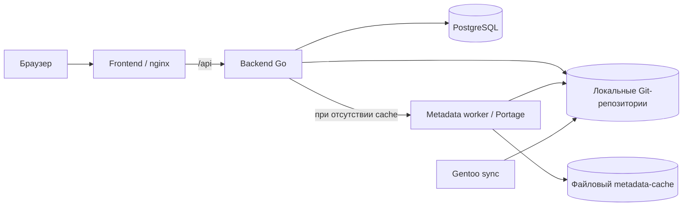

# Архитектура

Документ описывает текущее устройство сервиса и принятые границы. Подробные контракты компонентов приведены по ссылкам ниже; отложенные возможности перечислены отдельно.

## Назначение и границы

Сервис принимает текст плана `emerge`, разбирает показанные операции, применяет правила анализа и сравнивает доступные Gentoo metadata. Каждый вывод сопровождается основанием — evidence. Если данных недостаточно, отчёт показывает ограничение.

Сервис не запускает обновление и не изменяет систему пользователя. Подготовка metadata выполняется в отдельном Gentoo runtime. Завершённый анализ не означает, что обновление безопасно или одобрено; механизма approval сейчас нет.

## Компоненты

Backend написан на Go. Frontend использует TypeScript и Vite; в Compose собранные файлы отдаёт nginx, который также проксирует API. Анализ выполняется внутри одного backend, а `metadata-worker` запускает подготовку metadata средствами Portage.

Схема показывает обращения между компонентами. Основное дерево Gentoo синхронизирует сервис `gentoo`; дополнительные доверенные overlays подготавливает backend. Backend и worker читают основное дерево через volume только для чтения. Worker также читает overlays только для чтения и сохраняет подготовленные metadata в отдельный volume.

Frontend показывает полученные данные и не выполняет анализ самостоятельно. В Compose на host опубликован только frontend, по умолчанию на `127.0.0.1:8081`. Команды запуска и параметры описаны в [инструкции Compose](local-compose.md).

## Конфигурация backend

Backend один раз при запуске загружает defaults, явно указанный YAML и непустые env overrides, затем проверяет настройки до БД и очереди. Фабрики Provider и HTTP-клиент worker получают готовые значения; env внутри анализа не читается. В Compose файл подключён read-only. Смена его значений требует restart, env и bind source — recreate; DSN остаётся в env. Контракт — в [спецификации](../openspec/specs/backend-configuration/spec.md), поля и команды — в [руководстве backend](backend-configuration.md).

## Путь анализа

1. HTTP API v1 (`/api/v1/analyses`) проверяет запрос и сохраняет задание в PostgreSQL. Клиент получает `202 Accepted` и UUID.
2. Backend берёт задание из очереди PostgreSQL при свободном слоте: по умолчанию выполняется один анализ. До этого задание остаётся `pending/queued`, без разбора плана и подготовки репозиториев. После получения слота backend разбирает план, закрепляет ревизии необходимых репозиториев и сохраняет их в задании.
3. `planservice` объединяет результат Parser, findings Analyzer и отдельные отчёты `reportservice` по записям плана. Одинаковые metadata-запросы внутри одного анализа выполняются один раз.
4. Backend сохраняет прогресс и итоговый результат либо причину сбоя. Frontend опрашивает API по UUID.
5. Повторный GET читает сохранённое состояние. После перезапуска backend возвращает незавершённые задания в общую очередь; уже закреплённые ревизии сохраняются.

Очередь обслуживает один процесс backend. `analysis.concurrency_limit` в YAML и непустой env override `GENTOO_UPDATE_INTELLIGENCE_ANALYSIS_CONCURRENCY_LIMIT` задают предел активных анализов (`1` по умолчанию, `0` без ограничения). Каждый HTTP-анализ выполняет до двух независимых запросов metadata одновременно. Положительные лимиты `METADATA_WORKER_PREPARATION_LIMIT` и `METADATA_WORKER_GENERATION_LIMIT` ограничивают соответственно общую подготовку и генерации `egencache` (`2` по умолчанию каждый). Очередь хранится в базе; ожидающие задания не получают отдельные goroutine или checkout. Диспетчер запускается по уведомлению и повторяет временные ошибки чтения базы. Предел анализов не ограничивает размер очереди и не обеспечивает распределённое выполнение. Требования заданы в [спецификации подготовки metadata](../openspec/specs/automatic-metadata-preparation/spec.md), настройка — в [руководстве Compose](local-compose.md#число-активных-анализов).

Статус задания, полнота разбора и доступность metadata имеют разный смысл: `completed` означает завершение обработки, но результат Parser может быть `partial` или `unsupported`, а metadata отдельных пакетов — недоступными. Ошибка одного Lookup сохраняется в отчёте и не отменяет обработку остальных записей.

Публичные DTO v1 отделены от доменных моделей и прежнего JSON хранения. GET преобразует сохранённые результаты без повторного анализа; frontend и proxy используют полный версионированный путь. Контракт — в [спецификации API](../openspec/specs/http-api/spec.md).

Контракты: [HTTP API](http-api.md), [planservice](plan-service.md), [reportservice](report-service.md).

## Parser и Analyzer

[Parser](parser.md) извлекает только факты, присутствующие в поддерживаемом входе: пакеты, версии, операции, USE, SLOT, blockers и показанные удаления. Неподдерживаемые значимые строки отражаются в диагностике.

[Analyzer](analyzer.md) применяет детерминированные правила к результату Parser и явно переданному пользовательскому контексту. Сейчас реализованы `UNRESOLVED_BLOCKER`, `DOWNGRADE_PLANNED`, `LOCAL_PATCHED_PACKAGE`, `USE_CHANGED` и `SLOT_CHANGED`. Используются категории `BLOCKER` и `REVIEW`. Отсутствие findings не доказывает безопасность плана.

Findings Analyzer и metadata diff остаются отдельными частями результата. Analyzer не делает выводов о зависимостях или уязвимостях по metadata. AI не входит в критический путь анализа.

## Metadata и ChangeReport

[Metadata Provider](metadata-provider.md) читает точный cache из закреплённого commit локального Git-репозитория. Если cache не найден и worker настроен, backend передаёт ему точную версию и закреплённые ревизии. Worker ищет ebuild в истории и использует cache выбранной ревизии либо подготавливает его через `egencache`. Порядок поиска, повторное использование файлового cache и provenance описаны в [подготовке metadata](metadata-preparation.md).

[Metadata diff](metadata-diff.md) сравнивает `EAPI`, `SLOT/SUBSLOT` и объявления `IUSE` в пределах поддержки EAPI 8. Снимки сохраняют источник и SHA-256 содержимого. Это сравнение выбранных repository metadata: оно не подтверждает, что именно эти данные использовались при сборке установленного пакета.

[ChangeReport](change-report.md) содержит три независимых раздела:

| Раздел | Текущее состояние |
|---|---|
| Gentoo metadata | Ограниченное сравнение перечисленных выше полей с evidence и причинами недоступности. |
| Effective user configuration | `unavailable`: конфигурация пользователя не вычисляется. |
| Upstream enrichment | `unavailable`: release notes и другие upstream-данные не собираются. |

## Хранение и воспроизводимость

PostgreSQL хранит задания, их запросы, прогресс, закреплённые ревизии и результаты в `analysis_jobs`. Прежние результаты из `analyses` также доступны через GET. Backend применяет встроенные идемпотентные миграции. Точные поля и восстановление описаны в [HTTP API](http-api.md).

Файловый `metadata-cache` хранит подготовленные metadata с provenance. Он отделён от PostgreSQL и не хранит задания или результаты анализа. Redis сейчас не используется.

[Предметная модель](domain-model.md) задаёт логический смысл сущностей, evidence и ограничений воспроизводимости; её поля не следует воспринимать как готовую SQL-схему или JSON API.

## Отложенные возможности и открытые вопросы

Ранее принятые направления остаются планами, пока не согласован соответствующий этап:

- Расширение metadata diff: зависимости, `REQUIRED_USE`, `LICENSE`, `SRC_URI`, ebuild и Gentoo patches.
- Effective user configuration и причины изменений USE; upstream release notes, changelog и security notes с проверяемыми источниками.
- Review/approval и переходы `analyzed`, `needs_review`, `blocked`, `approved`; обработка категорий `SECURITY` и `CONFLICT`.
- Redis как восстанавливаемый кэш. Его удаление не должно приводить к потере сохранённых пользовательских данных.
- Отдельная физическая модель сущностей за пределами сохранённого результата анализа, ключи повторного использования и политика хранения.
- Эксплуатационные решения для постоянного развёртывания, включая резервное копирование PostgreSQL. Локальная Compose-приёмка не подтверждает их готовность.

Kubernetes и Cloudflare Tunnel ранее рассматривались как возможные направления развёртывания; их внедрение и модель внешнего доступа не входят в текущую реализацию. Без подтверждённой необходимости не добавляются микросервисы, Kafka, RabbitMQ, event-driven архитектура, Kubernetes CRD, service mesh, несколько backend-сервисов или автоматический запуск обновлений.
