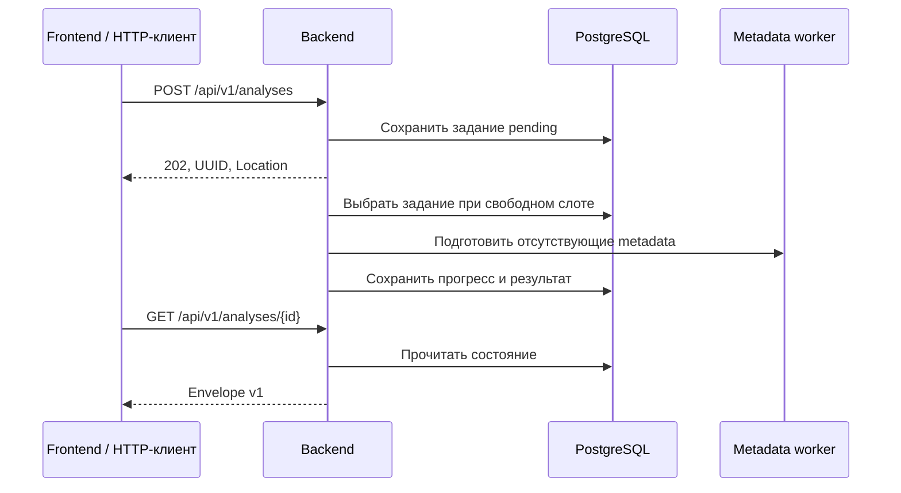

# HTTP API v1

API принимает план, сохраняет задание и возвращает UUID для наблюдения за обработкой и повторного чтения результата. Основной источник требований к маршрутам, DTO, ошибкам и совместимости — [спецификация HTTP API](../openspec/specs/http-api/spec.md). Этот документ поясняет контракт, хранение и использование.

## Адреса

| Назначение | Создание | Чтение |
|---|---|---|
| Backend напрямую | `POST /api/v1/analyses` | `GET /api/v1/analyses/{id}` |
| Через Compose frontend proxy | `POST /api/v1/analyses` | `GET /api/v1/analyses/{id}` |
| Страница frontend | — | `/analyses/{id}` |

Nginx и Vite передают полный API-путь без снятия `/api`. Proxy сохраняет HTTP-код, `Content-Type`, `Location` и тело ответа. Неизвестный API-путь возвращает JSON-ошибку, а не HTML приложения. Прежние `/analyses` в backend и `/api/analyses` через proxy больше не обслуживаются; перенаправлений POST нет. Прямые ссылки на страницы отчётов сохраняются.



## Отправка задания

`POST /api/v1/analyses` принимает один JSON-объект с `Content-Type: application/json`:

```json
{
  "plan": "[ebuild U] dev-libs/libxml2-2.14.6::gentoo [2.13.9::gentoo]",
  "locally_patched_packages": [
    {"category": "dev-libs", "name": "libxml2"}
  ]
}
```

`plan` — обязательная непустая строка. `locally_patched_packages` — необязательный список точных `category/name` без версий. Пропущенный или пустой список означает пустой Analyzer context. Он сообщает пользовательское знание о локальных патчах; сервис сам их не обнаруживает.

Размер тела ограничен 4 MiB. Неизвестные поля, дополнительные JSON-значения и неправильные типы отклоняются. В именах допустимы только ASCII-буквы, цифры и разделители Gentoo: для category — `+_.-`, для name — `+_-`. Category не начинается с `+`, `.` или `-`; name — с `+` или `-` и не содержит суффикса версии. Строка плана длиннее 2 MiB добавляет Parser diagnostic `MALFORMED_ENTRY`, но сама по себе не отклоняет POST. Parser `partial` и `unsupported` также не отклоняют корректный запрос.

UUID выдаётся только после сохранения задания:

```http
HTTP/1.1 202 Accepted
Content-Type: application/json; charset=utf-8
Location: /api/v1/analyses/5908ca14-ae9f-43d6-bb64-d7038775d94d
```

```json
{
  "id": "5908ca14-ae9f-43d6-bb64-d7038775d94d",
  "status": "pending",
  "progress": {"stage": "queued", "completed": 0, "total": 0},
  "result": null,
  "error": null
}
```

`Location` теперь ведёт на API как напрямую, так и через proxy. Для страницы отчёта используйте `/analyses/{id}`. Повторный POST с тем же телом создаёт новое задание; автоматического повторения после сетевой ошибки нет, поскольку сохранение могло состояться.

## Состояние и очередь

`GET /api/v1/analyses/{id}` возвращает `200` и envelope с пятью полями: `id`, `status`, `progress`, `result`, `error`.

`GET /api/v1/analyses/{id}/report` возвращает тот же envelope с компактным результатом: в Lookup сохранены query, status, error и skip_reason, а полные snapshots и provenance исключены. Данные плана, findings, evidence, metadata diff и ограничения доступны в компактном ответе. Для полных технических данных используйте прежний GET. Оба маршрута читают сохранённый результат без повторного анализа.

`GET /api/v1/analyses/{id}/partial-report` возвращает состояние, прогресс и компактный промежуточный результат, когда Parser и Analyzer уже завершены. Массив `pending_entries` содержит индексы записей, для которых отчёт metadata ещё не готов; готовые отчёты расположены в порядке плана. При ошибке задания сохраняются доступные данные и возвращается `error`. Для завершённого или ранее сохранённого анализа маршрут возвращает компактный итоговый результат с пустым `pending_entries`. До появления первых данных `result` равен `null`. Существующие маршруты сохраняют прежнюю семантику `result`.

| Статус | Значение | `result` | `error` |
|---|---|---|---|
| `pending` | Задание сохранено и ждёт выполнения. | `null` | `null` |
| `running` | Подготовка репозиториев или анализ. | `null` | `null` |
| `completed` | Обработка завершена. | DTO результата | `null` |
| `failed` | Задание целиком завершилось ошибкой. | `null` | Объект с `code` и `message` |

Например, недоступность Provider после принятия запроса видна в GET:

```json
{
  "id": "5908ca14-ae9f-43d6-bb64-d7038775d94d",
  "status": "failed",
  "progress": {"stage": "failed", "completed": 0, "total": 2},
  "result": null,
  "error": {"code": "ANALYSIS_FAILED", "message": "metadata provider is unavailable"}
}
```

По умолчанию один backend выполняет один анализ. Остальные задания хранятся в PostgreSQL как `pending/queued`, без Parser, подготовки репозиториев и отдельной ожидающей goroutine. Выбор идёт по `created_at, id`; ревизии нового задания закрепляются при начале обработки. После сохранения `completed` или `failed` слот освобождается. Временные ошибки чтения очереди повторяются автоматически.

`GENTOO_UPDATE_INTELLIGENCE_ANALYSIS_CONCURRENCY_LIMIT` задаёт предел: `1` по умолчанию, положительное целое ограничивает активные анализы, `0` отключает его. Положительный лимит генераций worker независим (`2` по умолчанию). Очередь рассчитана на один backend, не ограничивает число принятых заданий и размер хранения. Контракт очереди — в [спецификации подготовки metadata](../openspec/specs/automatic-metadata-preparation/spec.md), команды — в [руководстве Compose](local-compose.md#число-активных-анализов).

`progress` содержит `stage`, `completed`, `total`. До разбора `total` равен `0`, затем — числу уникальных metadata Query. Каждый Query учитывается один раз; `completed` увеличивается после Lookup, включая Lookup с ошибкой. Запросы, пропущенные из-за отклонённой привязки, в это число не входят. Этапы: `queued`, `preparing`, `analyzing`, `completed`, `failed`. После восстановления задания обработка начинается заново, поэтому прогресс может сброситься.

## DTO результата

JSON v1 не зависит от регистра Go-имён. Все имена полей — `snake_case`; значения `EAPI`, `SLOT`, `IUSE`, коды правил и диагностик сохраняют регистр. Списки всегда массивы, включая `[]`; словари — объекты, включая `{}`. Отсутствующие объекты и необязательные значения представлены `null`. Известная пустая строка и индекс `0` сохраняют свой смысл.

| Поле | Содержимое |
|---|---|
| `result.plan` | Статус Parser, entries, blockers, removals, summary, conflict_summary и diagnostics. |
| `result.analysis` | Статус Analyzer, diagnostics и findings. |
| `result.reports` | Отчёты по разобранным записям: report, before_lookup, after_lookup. |
| `result.repositories` | Словарь закреплённых ревизий по именам repository; пустой словарь, если они отсутствуют в старом результате. |

Parser `partial` или `unsupported` не делает задание `failed`. `completed` означает завершение обработки, а не безопасность обновления.

В `reports[].report` находятся `entry_index`, `source_lines`, `parser_status`, `parser_diagnostics`, `gentoo`, `effective_config`, `upstream` и `interpretation_limitation`. Gentoo содержит статус, comparison или diagnostics привязки. Comparison сохраняет `compared_fields`, изменения `eapi`, `slot`, `subslot`, `iuse`, limitations и ссылки before/after с источниками и SHA-256.

Каждый `before_lookup` и `after_lookup` содержит:

- `query`: точный запрос metadata или `null`, если Lookup не выполнялся;
- `result`: status, snapshot и provenance либо `null`;
- `error`: `null` или `{ "code": "METADATA_LOOKUP_FAILED", "message": "..." }`;
- `skip_reason`: строку с причиной пропуска, если он был.

Snapshot сохраняет `source`, точные `content` и `sha256`, нормализованные `eapi`, `slot`, `iuse`, diagnostics. Provenance подготовленных metadata сохраняет ebuild и blob, reference/selected commits, профиль, версию Portage, cache SHA-256, аргументы, stdout/stderr и окружение генерации, masters. Строковое содержимое metadata и provenance не переименовывается. Локальный Path закреплённого repository не сериализуется; диагностические пути внутри provenance сохраняются.

Findings содержат `rule_id`, `category`, `message`, nullable `entry_index` и evidence:

| Правило | Поля evidence |
|---|---|
| `LOCAL_PATCHED_PACKAGE` | `context_index` |
| `USE_CHANGED` | `tokens[]`: `group_index`, `value_index` |
| `SLOT_CHANGED` | `installed_version_index` |
| `DOWNGRADE_PLANNED` | `entry_index`, `operation`, `installed_versions`, `target_version` |
| `UNRESOLVED_BLOCKER` | `blocker_index` |

Индексы нулевые, номера исходных строк — с единицы. Finding без привязки к записи сохраняет `entry_index: null`; отсутствие evidence в прежнем результате передаётся как `null`.

Полные типы DTO находятся в [HTTP-слое](../backend/internal/analysishttp/dto_v1.go), TypeScript-типы — в [api-types.ts](../frontend/src/api-types.ts), пример полного ответа — в [fixture v1](../backend/internal/analysishttp/testdata/v1-found.json).

## Ошибки

HTTP-ошибка возвращает объект без UUID:

```json
{"error":{"code":"INVALID_REQUEST","message":"plan must be a non-empty string"}}
```

| HTTP | Код | Причина |
|---|---|---|
| `400` | `INVALID_REQUEST` | Некорректное тело или поля, включая превышение 4 MiB. |
| `415` | `UNSUPPORTED_MEDIA_TYPE` | Content-Type не application/json; корректные параметры media type допускаются. |
| `404` | `ANALYSIS_NOT_FOUND` | Неизвестный или некорректный UUID известного endpoint. |
| `404` | `NOT_FOUND` | Неизвестный путь или версия API, в том числе прежний адрес. |
| `405` | `METHOD_NOT_ALLOWED` | Неподдерживаемый метод известного endpoint; `Allow` перечисляет допустимые. |
| `503` | `STORAGE_UNAVAILABLE` | Ошибка чтения или сохранения в БД. |
| `500` | `INVALID_STORED_RESULT` | Сохранённый JSON повреждён или не может быть преобразован в DTO v1. |
| `500` | `INTERNAL_ERROR` | Другая внутренняя ошибка обработчика. |

Ошибка всего задания (`ANALYSIS_FAILED`) и отдельного Lookup (`METADATA_LOOKUP_FAILED`) имеют разные уровни. Lookup со статусом `not_found` или `repository_unavailable` не является ошибкой всего задания: он остаётся частью completed отчёта. Другие записи продолжают обрабатываться. Frontend показывает message как текст, в том числе для неизвестного code.

## Хранение и совместимость

PostgreSQL хранит задания, запросы, прогресс, закреплённые ревизии и результаты в `analysis_jobs`. Прежние результаты из `analyses` также читаются по UUID с completed envelope. Backend применяет встроенные идемпотентные миграции.

Формат JSON в базе остаётся прежним. GET читает его через типизированный адаптер и отдаёт DTO v1, не вызывает Provider, не запускает анализ и не перезаписывает результат. Доменные модели, CLI и внутренний протокол metadata worker не переводятся на публичный JSON v1.

При запуске единственного backend прерванные `running` возвращаются в очередь вместе с `pending`. Закреплённые commits сохраняются и используются при повторном выполнении. Если они недоступны, задание получает failed с причиной. Если commits ещё не закреплены, обработка заново выбирает ревизии.

Backend сначала ищет точный repository cache. При not_found и настроенном worker он запрашивает подготовку metadata. Файловый metadata-cache сохраняет подготовленные данные, PostgreSQL — задания и отчёты; это разные хранилища.

Удаление, переименование, изменение типа или смысла поля требует новой major-версии. Клиенты допускают дополнительные поля. Несовместимое расширение состояний не вводится в v1. Внутренние версии приложения, схема БД и версия HTTP API не обязаны совпадать.

## Применение и конфигурация

При обновлении со старого API backend и frontend нужно пересобрать и пересоздать вместе: прежний frontend не совместим с маршрутами и DTO v1. Команды приведены в [руководстве Compose](local-compose.md#повторный-запуск-и-обновление). Миграция БД и пересборка Gentoo runtime для этого перехода не нужны. После обновления проверьте прежний UUID и создание нового анализа. При откате прежний формат результатов в базе остаётся совместимым со старой парой backend/frontend.

Backend по умолчанию слушает `127.0.0.1:8080`, в Compose — `0.0.0.0:8080` во внутренней сети. На хост публикуется только frontend на loopback. Настройки YAML/env описаны в [руководстве backend](backend-configuration.md), команды полного стека — в [руководстве Compose](local-compose.md).

## Пересборки и полнота разбора

DTO v1 передаёт `operation: "reinstall"` для Portage `R` и `summary.reinstalls` при наличии сводки. Прежние сохранённые результаты без этого счётчика читаются со значением 0, без миграции БД. Вложенность JSON и маршруты сохраняются. `installed.versions` содержит только явно показанный контекст; целевая версия пересборки не становится установленной.

Для пересборки без установленной стороны `before_lookup` не имеет запроса и содержит существующий `skip_reason: "BINDING_REJECTED"`. Целевые metadata запрашиваются при известном repository и проверяются по package, version, repository и явно показанным SLOT/SUBSLOT. `INSTALLED_CONTEXT_MISSING` и недоступность сравнения сохраняются независимо от результата after Lookup. Ошибка Provider остаётся исходом Lookup, а не ошибкой всего анализа.

UI обозначает такие записи как «Пересборка» и предупреждает об отсутствующей установленной стороне. Для Parser `partial` и `unsupported` отдельное предупреждение сообщает, что анализ охватывает только распознанные записи: отсутствие findings не характеризует весь вход. «Распознано пакетов» показывает число извлечённых записей, общий счётчик берётся только из сводки Portage. Ограничения metadata comparison показываются отдельно от полноты разбора.

Сохранённые анализы автоматически не переразбираются. Чтобы получить полный разбор ранее частичного плана после обновления, пользователь запускает новый анализ.
