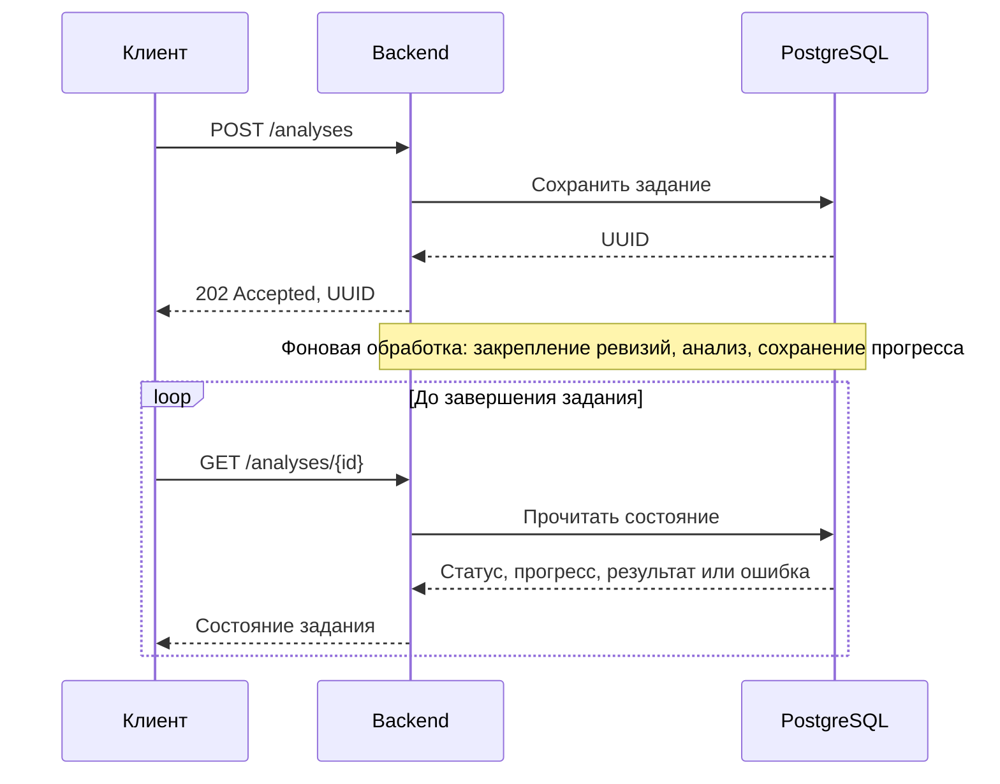

# HTTP API сохранённого анализа

API принимает текст emerge plan, сохраняет задание в PostgreSQL и возвращает UUID до начала фонового анализа. Клиент использует этот UUID для проверки состояния и получения результата или причины сбоя. API не запускает `emerge` напрямую.

| Точка входа | Отправка задания | Проверка задания |
|---|---|---|
| Backend напрямую | `POST /analyses` | `GET /analyses/{id}` |
| API через Compose frontend proxy | `POST /api/analyses` | `GET /api/analyses/{id}` |
| Страница frontend | — | `/analyses/{id}` — страница приложения, не API |

Compose frontend удаляет префикс `/api` при проксировании в backend и передаёт клиенту HTTP-код, `Content-Type` и тело ответа.

## Путь задания



Схема показывает успешное принятие запроса. Если задание не удалось сохранить, API возвращает ошибку без UUID. Повторное открытие по UUID читает сохранённое состояние и не запускает анализ заново.

## Отправка задания

### `POST /analyses`

Запрос должен иметь `Content-Type: application/json` и содержать один JSON-объект:

```json
{
  "plan": "[ebuild U ] dev-libs/libei-1.6.0-r1",
  "locally_patched_packages": [
    {"category": "dev-libs", "name": "libei"}
  ]
}
```

`plan` — обязательная непустая строка с исходным текстом плана. Поле `locally_patched_packages` необязательно; это список точных Gentoo `category` и `name`. Пропущенный или пустой список означает пустой Analyzer context.

Размер тела ограничен 4 MiB. Запрос должен содержать корректный JSON без неизвестных полей или дополнительных JSON-значений. Каждый элемент `locally_patched_packages` должен содержать допустимую пару `category`/`name`: `category` и `name` — отдельные имена без версии; допустимы только буквы ASCII, цифры и разделители Gentoo (`category`: `+_.-`, `name`: `+_-`). `category` не может начинаться с `+`, `.` или `-`; `name` не может начинаться с `+` или `-` и не должен включать суффикс версии. Строка плана длиннее 2 MiB добавляет Parser diagnostic `MALFORMED_ENTRY`, но сама по себе не отклоняет POST. Статусы Parser `partial` и `unsupported` также не отклоняют запрос.

При успешном сохранении backend отвечает `202 Accepted`, выдаёт UUID и устанавливает `Location` с адресом GET:

```http
HTTP/1.1 202 Accepted
Content-Type: application/json; charset=utf-8
Location: /analyses/28b28f31-7e85-4e6a-a839-84658f32cc74
```

```json
{
  "id": "28b28f31-7e85-4e6a-a839-84658f32cc74",
  "status": "pending",
  "progress": {
    "stage": "queued",
    "completed": 0,
    "total": 0
  }
}
```

UUID возвращается только после сохранения задания. Ошибка открытия Provider или выполнения анализа после этого отражается в состоянии задания, а не в ответе POST. Повторный POST, даже с тем же телом, создаёт новое задание и новый UUID.

В Compose используйте `id` для опроса `GET /api/analyses/{id}`. Заголовок `Location` содержит backend-путь `/analyses/{id}`; через Compose frontend этот путь открывает страницу приложения.

Ошибки POST возвращаются JSON-объектом `{"error":"..."}` без UUID:

| HTTP-код | Причина |
|---|---|
| `400 Bad Request` | Некорректный JSON, несколько JSON-значений, неизвестное поле, неверный тип или недопустимое значение поля, пустой `plan`; сюда же обработчик относит ошибку чтения тела, в том числе превышение 4 MiB. |
| `415 Unsupported Media Type` | Обработчик разбирает `Content-Type` и проверяет media type: он должен быть `application/json`. Параметры разрешены, например `application/json; charset=utf-8`. |
| `500 Internal Server Error` | Не удалось сериализовать запрос для сохранения. |
| `503 Service Unavailable` | Хранилище недоступно или не удалось сохранить задание. |

## Проверка состояния

### `GET /analyses/{id}`

Подставьте UUID из `id` ответа POST или используйте путь из заголовка `Location`:

```http
GET /analyses/28b28f31-7e85-4e6a-a839-84658f32cc74
```

Для задания с таким UUID ответ `200 OK` содержит `id`, `status` и `progress`. По завершении в ответ добавляется `result`, а при сбое задания — `error`:

```json
{
  "id": "28b28f31-7e85-4e6a-a839-84658f32cc74",
  "status": "completed",
  "progress": {
    "stage": "completed",
    "completed": 2,
    "total": 2
  },
  "result": {
    "Plan": {},
    "Analysis": {},
    "Reports": []
  }
}
```

Возможны четыре состояния:

| `status` | Значение | Доступные поля |
|---|---|---|
| `pending` | Задание сохранено и ожидает обработки. | `progress`; `result` и `error` отсутствуют. |
| `running` | Идёт подготовка или анализ. | `progress`; `result` и `error` отсутствуют. |
| `completed` | Анализ завершён. | `result`; `error` отсутствует. |
| `failed` | Задание целиком завершилось ошибкой. | `error` с причиной; `result` отсутствует. |

`progress` содержит `stage`, `completed` и `total`. До разбора плана `total` равен `0`; затем `total` равен числу уникальных metadata `Query`, необходимых для отчётов. Каждый уникальный `Query` учитывается один раз, а `completed` увеличивается после его Lookup, в том числе если Lookup вернул ошибку. Запросы, которые не выполнялись из-за отклонённой привязки, в это число не входят. При восстановлении незавершённого задания обработка начинается заново, поэтому прогресс текущего запуска может сброситься.

GET не запускает анализ повторно. Ошибки самого GET также возвращаются JSON-объектом `{"error":"..."}`:

| HTTP-код | Причина |
|---|---|
| `404 Not Found` | `id` имеет неверный формат UUID или задание с таким UUID не найдено. |
| `500 Internal Server Error` | Сохранённый результат содержит некорректный JSON. |
| `503 Service Unavailable` | Хранилище недоступно. |

## Результат анализа

JSON-поля результата сохраняют регистр имён Go-структур: `Plan`, `Analysis`, `Reports` и, если доступны закреплённые репозитории, `Repositories`. `Plan` содержит результат Parser: статус `parsed`, `partial` или `unsupported`, разобранные записи, blockers, removals, сводку и diagnostics. `Analysis` содержит статус Analyzer, diagnostics и findings с их evidence. Неуспешная или частичная обработка Parser не делает задание `failed`.

`Reports` содержит отдельный отчёт для каждой разобранной записи. Элемент включает `Report`, `BeforeLookup` и `AfterLookup`. Вложенные поля сохраняют исходные имена: например, `Report`, `EntryIndex`, `SourceLines`, `Gentoo`, `EffectiveConfig`, `Upstream`, `Query`, `Result`, `Err` и `SkipReason`. Сами отчёты сохраняют diagnostics привязки, результаты сравнения metadata и ограничения неподдерживаемых секций.

В каждом исходе Lookup:

- `Query` описывает точный запрос metadata и может быть `null`, если Lookup не выполнялся;
- `Result` содержит `Status`, `Snapshot` и, для подготовленных metadata, поле `provenance`;
- `Err` содержит строку из `error.Error()`, если Lookup завершился ошибкой;
- `SkipReason` объясняет, почему Lookup был пропущен.

`Snapshot` содержит нормализованные Gentoo metadata и источник. Вложенное поле `Result.provenance` подготовленной metadata сохраняет источник и ревизии репозиториев, выбранный ebuild и его blob, профиль, версию Portage, параметры и результат `egencache`, а также контрольную сумму cache. `Repositories` в результате перечисляет закреплённые ревизии с именами, URL, commit и masters; локальные пути не сериализуются.

Ошибка всего задания и ошибка одного Lookup имеют разный смысл:

| Где указана | Значение |
|---|---|
| `status: "failed"` и верхнеуровневое `error` | Обработка задания целиком не завершилась, например Provider недоступен, закреплённую ревизию нельзя восстановить или анализ не удалось сериализовать. Итогового `result` нет. |
| `Reports[].BeforeLookup.Err` или `Reports[].AfterLookup.Err` | Не удался отдельный Lookup или подготовка metadata для одной стороны. Само задание может иметь `status: "completed"`; остальные записи продолжают обрабатываться и включаются в `Reports`. |

Результат Lookup со статусом `not_found` или `repository_unavailable` сам по себе не является ошибкой всего задания: это значение находится в `Result.Status`. Если сравнение невозможно, отчёт сохраняет доступные diagnostics или причину для соответствующей стороны.

## Хранение и восстановление

PostgreSQL — постоянное хранилище заданий и анализов. Backend применяет встроенные идемпотентные миграции: таблица `analysis_jobs` хранит запрос, статус, прогресс, ошибку, закреплённые ревизии и результат; прежняя таблица `analyses` сохраняет ранее созданные результаты. Старый UUID из `analyses` по-прежнему читается через GET со статусом `completed` и прежним `result`.

При старте backend восстанавливает задания `pending` и `running`, повторяя обработку с начала. Если ревизии репозиториев уже сохранены, Provider открывается на тех же commits; если ревизии ещё не записаны, backend заново выбирает их. Если закреплённые commits или нужные Git-объекты недоступны либо восстановление невозможно по другой причине, задание получает `failed` с причиной. UUID остаётся доступным для GET. Перезапуск не меняет результат уже завершённого задания, сохранённый в PostgreSQL.

Backend ищет точный cache в закреплённой Git-ревизии. Если Lookup возвращает `not_found` и настроен `GENTOO_UPDATE_INTELLIGENCE_METADATA_WORKER_URL`, backend передаёт worker точный запрос и закреплённые ревизии. Worker может подготовить metadata по точной версии и сохранить их в файловом `metadata-cache`; результат и provenance подготовки попадают в `Reports[].BeforeLookup.Result` или `Reports[].AfterLookup.Result`. `metadata-cache` хранит подготовленные metadata, а PostgreSQL — задания и результаты анализа.

Backend по умолчанию слушает `127.0.0.1:8080`; в Compose он слушает `0.0.0.0:8080` во внутренней сети, а на host публикуется только frontend на loopback.

## Конфигурация

Настройки Compose и параметры окружения backend описаны в разделе [«Настройки» инструкции Compose](local-compose.md#настройки). В этом документе приведён только контракт API.
