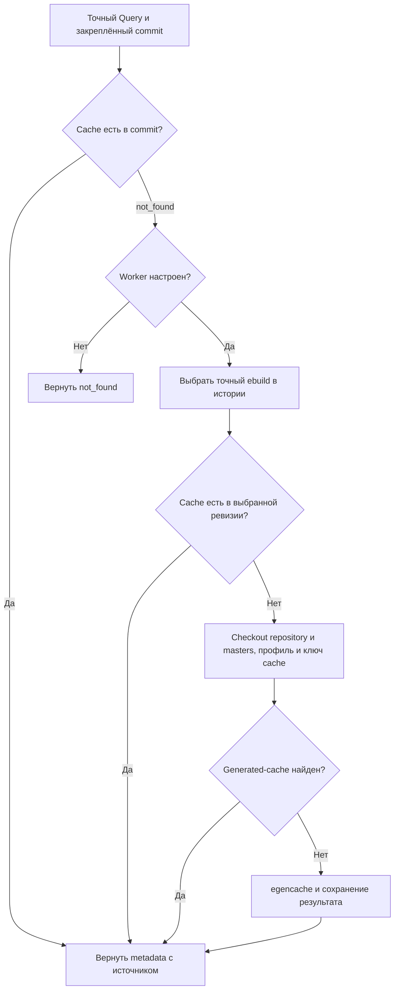

# Выбор source revision и подготовка metadata

**Статус:** resolver, generator, metadata-worker и их связь с [Metadata Provider](metadata-provider.md) реализованы. Ниже описано фактическое поведение backend; настройка запуска находится в [инструкции Compose](local-compose.md), контракт заданий — в [HTTP API](http-api.md).

Подготовка разделяет выбор source revision, чтение готовых cache-снимков, генерацию metadata и их повторное использование. Репозитории для анализа закрепляются отдельно; пользовательский план не задаёт URL источника.

## 1. Выбор source revision

### Вход и точный путь

Вход resolver:

- локальный Git repository и его логическое имя repository;
- полный SHA commit, от которого начинается поиск (`reference commit`);
- точные `category/name` и `version`.

Искомый путь строится без подстановок и поиска похожих версий:

```text
category/name/name-version.ebuild
```

Resolver использует только объекты локального repository. Полный `reference commit` должен существовать и быть commit-объектом. Отсутствующий объект, неверный тип объекта и ошибка Git считаются техническими ошибками и не являются основанием для `not_found`.

### Правило выбора

Поиск начинается с `reference commit`. Если по точному пути там нет обычного ebuild-файла, resolver последовательно проверяет first-parent ancestor, затем его first-parent ancestor и так далее. Первый найденный файл — ближайшее совпадение по этой цепочке.

Порядок обхода определяется только связями parent в Git-графе:

- даты commits не сортируются и не используются для выбора;
- поиск не переходит во вторые и последующие родители merge commit;
- rename не отслеживается: в каждом commit проверяется только исходный точный путь.

Обычным ebuild-файлом считается запись с типом `blob` и файловым mode `100644` или `100755`. Symlink, tree, submodule и другие типы записей не считаются ebuild. Их наличие по искомому пути даёт техническую ошибку с причиной неподдерживаемого типа, а не `found` или `not_found`.

### Исходы

| Исход | Условие |
|---|---|
| `found` | Обычный blob найден в `reference commit` или в ближайшем first-parent ancestor. |
| `not_found` | Поиск дошёл до настоящего корня полной first-parent истории, и точный путь нигде не найден. |
| `history_incomplete` | Поиск дошёл до shallow-границы, не найдя файл. Неизвестная или недоступная parent-запись сама по себе не доказывает shallow-границу. |
| Техническая ошибка | Reference или нужный Git-объект отсутствует либо имеет неверный тип, Git завершился с ошибкой, либо точный путь содержит неподдерживаемую запись. |

Если файл найден до shallow-границы или непосредственно в commit на этой границе, исход — `found`. Историю дальше доступных объектов в этом случае искать не требуется. `not_found` нельзя возвращать, если полнота first-parent истории не установлена.

Результат `found` сохраняет reference commit, выбранный commit, точный путь и blob ID. Причина `at_reference` означает, что файл найден в reference commit; `first_parent_history` означает, что он найден в более раннем commit first-parent цепочки. Это provenance выбора исходника; оно не подтверждает, что выбранный ebuild использовался для установленной сборки.

## 2. Генерация metadata

### Порядок поиска metadata



На схеме показан порядок поиска при успешных промежуточных шагах. Ошибка Provider не запускает worker; ошибки разрешения ebuild или подготовки сохраняются в Lookup соответствующей стороны отчёта.

Для каждого точного `Query` backend действует в следующем порядке:

1. `pinnedRepositories` вызывает Metadata Provider для закреплённого commit запрошенного repository. Если точный cache найден, он сразу передаётся в отчёт; worker не вызывается.
2. Если Provider вернул `not_found`, worker вызывается только при настроенном `GENTOO_UPDATE_INTELLIGENCE_METADATA_WORKER_URL`. Без URL исход `not_found` возвращается без поиска истории и генерации. Ошибка Provider также не запускает worker.
3. Worker запускает resolver от закреплённого reference commit и ищет точный ebuild в first-parent истории. Если ebuild не найден или история неполна, подготовка завершается соответствующей ошибкой.
4. Для выбранного ebuild worker открывает Provider на `SelectedCommit` и снова проверяет точный cache этой ревизии. Если cache найден, он возвращается без запуска `egencache` и без чтения файлового generated-cache.
5. Если cache отсутствует и в выбранной ревизии, worker читает версию Portage и создаёт временный checkout repository на `SelectedCommit` и checkout всех закреплённых masters. На этих checkout он определяет канонический путь профиля и только затем строит полный ключ и вызывает `Store.Load`. При попадании сохранённый результат возвращается без запуска генератора. При промахе `Store.Load` worker создаёт каталог генерации, запускает `egencache` и сохраняет результат; checkout уже созданы к моменту чтения файлового cache.

Таким образом, cache закреплённого commit имеет приоритет перед историческим cache, а исторический cache — перед повторно используемым generated-cache и новой генерацией. Попадание в файловое хранилище экономит запуск `egencache`, но не создание временных checkout и не определение канонического пути профиля. Файловое хранилище содержит только результаты генерации; найденный в Git cache туда не сохраняется.

### Параметры генератора

Генератор принимает только результат resolver со статусом `found`, точные `category/name` и `version`, временный checkout с `HEAD`, равным `SelectedCommit`, выбранный профиль и отдельный существующий временный каталог. Профиль должен находиться в исходном checkout или закреплённом master checkout.

До запуска генератор проверяет чистоту checkout, точный путь и blob ebuild, совпадение содержимого рабочей копии с blob и отсутствие готового cache для запрошенной версии. Каталоги конфигурации и промежуточного cache создаются внутри временного каталога.

Временный `config-root/etc/portage/make.profile` указывает на выбранный профиль. По умолчанию `--repositories-configuration` задаёт `[gentoo]` с `location`, указывающим на выбранный checkout. Для overlay генератор также принимает имя repository и список master checkouts с полными commit SHA. Он проверяет, что каждый master является чистым checkout с указанным `HEAD`, и добавляет его в конфигурацию. Профиль может находиться в исходном checkout или в одном из проверенных masters. Явные `PORTAGE_USERNAME` и `PORTAGE_GRPNAME` можно задать только для локального прогона через конфигурацию генератора; по умолчанию оба параметра не задаются.

Генератор вызывает `egencache --ignore-default-opts --repo <repository> --update category/name` с временными `--config-root`, `--cache-dir` и текстом конфигурации репозиториев. По умолчанию repository — `gentoo`. Он использует обычную генерацию в выделенном временном checkout, без `--external-cache-only` и `--tolerant`. После успешного завершения читает только точный файл из `metadata/md5-cache/category/name-version`; отсутствие этого файла считается ошибкой. `egencache` и проверка версии Portage получают ограниченное окружение: `PATH`, временные `HOME` и `TMPDIR`, а также `LANG=C`.

`egencache` принимает имя пакета `category/name`, а не version-specific atom. Поэтому команда может обработать несколько версий пакета, присутствующих в выбранном checkout. Из результатов выбирается только cache точной запрошенной версии:

```text
metadata/md5-cache/category/name-version
```

Наличие другого cache-файла не подтверждает успешную генерацию требуемой версии.

Provenance генерации фиксирует:

- reference commit, выбранный source commit, ebuild path и blob ID;
- причину выбора ebuild, выбранный профиль и версию Portage;
- исполняемый файл и параметры `egencache`, текст конфигурации репозиториев, `PATH` и явные локальные настройки Portage;
- точный путь и SHA-256 полученного cache-файла;
- имена и закреплённые commits переданных master repositories.

### Worker и файловый cache

Результат генератора содержит точные байты cache, SHA-256 и полную provenance генерации. В Compose backend вызывает внутренний `metadata-worker` только после `not_found` в закреплённой ревизии и только при настроенном URL worker. Worker объединяет одновременные запросы с одинаковым полным телом запроса до resolver и создания временных checkout; ожидающие получают общий результат или ошибку.

После завершения вызова запись дедупликации удаляется, поэтому последующий запрос проходит подготовку снова, но может использовать постоянный generated-cache.

Для разных ключей число одновременных запусков именно генератора ограничивает общий для worker положительный предел `METADATA_WORKER_GENERATION_LIMIT` (по умолчанию `2`); разрешение ebuild, поиск cache и загрузка сохранённого результата этим пределом не ограничиваются. Отмена HTTP-запроса прекращает ожидание его клиента, но не отменяет общую подготовку для других ожидающих.

Если worker находит cache в выбранной исторической ревизии, его `Provenance` содержит reference и selected commits, причину выбора, путь и blob ebuild, путь и SHA-256 cache и закреплённые masters. Эти сведения описывают происхождение исходного ebuild и cache; поля запуска Portage и `egencache` в этом исходе не заполняются. При генерации `Provenance` также содержит профиль, версию Portage, параметры и конфигурацию `egencache`, окружение и SHA-256 результата. Повторное использование generated-cache возвращает сохранённую полную provenance генерации. Для cache, найденного сразу в закреплённой ревизии, `LookupResult.Provenance` не задаётся: источник отражён в `Snapshot.Source`.

`backend/internal/metadatacache` предоставляет ключ совместимости и атомарное файловое хранение с проверкой содержимого и provenance. Ключ включает repository и source URL, точную версию, reference и selected commits, ebuild blob, упорядоченный список masters, профиль, версию генератора и Portage. Смена любого из этих входов, включая commit master, даёт другой ключ. Файловый cache хранится в отдельном Compose volume `metadata-cache`. Ошибка worker возвращается в Lookup соответствующей стороны отчёта и не прерывает обработку других записей.

Source commit и commit локального cache-снимка — разные идентификаторы с разным смыслом. Первый указывает на ebuild и его исходное окружение, второй — на Git-объект cache-файла, который будет читать Provider. Их нельзя подменять друг другом. Генерация не означает сборку пакета или загрузку его исходников.

### Пример реальной проверки

В реальном прогоне `libei` от reference `f7cf26b2201cf32c7fd24df761e1cf3c43992b2b` resolver выбрал для `1.6.0` commit `88a930a93edbc5b6e21fbf80748e649281dae402` (`first_parent_history`, blob `a8eff45bf70ce0ba8dc7a339138327880da5a62e`), а для `1.6.0-r1` — сам reference (`at_reference`, blob `ad24b229728f7d312f94503c79590e3a78b9cd61`). Во временной копии checkout для первого выбора снята shallow-граница с `f7cf26b…`: его parent `88a930a…` уже был доступен локально; сама граница на `88a930a…` сохранена. Исходный checkout не менялся, fetch не выполнялся.

Обе генерации прошли на Portage `3.0.82.2` с профилем `profiles/default/linux/amd64/23.0`. На этом хосте для промежуточного каталога потребовались явные локальные `PORTAGE_USERNAME="vladimir"` и `PORTAGE_GRPNAME="vladimir"` во временном `make.conf`. SHA-256 cache: `1.6.0` — `0168526a96c712e1fad72f920ba5fbf3af34ddbcca1fd69db5c211448ffa0002`; `1.6.0-r1` — `e0d82b81a0e872e19cefc32a1f0229a23628726acf8a2ecd2ad53e965f4337e8`.

Отдельный Git-снимок содержит ровно два cache-файла и два файла provenance; его commit — `1d1580515aeae5bf0c3d33a9d7d099bdc4a2aed3`. CLI на строке перехода `1.6.0 → 1.6.0-r1` вернул `found` для обоих Lookup и использовал оба указанных SHA-256. В текущем сравнении EAPI, SLOT/SUBSLOT и IUSE diff пуст. Сырые cache отдельно подтверждают изменения `DEPEND` и `RDEPEND`. Артефакты, логи и JSON находятся в `/tmp/gentoo-metadatagenerator-real.r2zQ4p/artifacts`.

## 3. Чтение готовых снимков существующим Provider

Metadata Provider получает локальный Git repository, логическое имя repository и полный commit cache-снимка. По запросу `category/name/version` он читает точный объект:

```text
metadata/md5-cache/category/name-version
```

Provider не выбирает ebuild revision, не запускает `egencache`, не выполняет fetch и не изменяет repository. `not_found` у Provider означает отсутствие точной cache-записи в заданном commit; это не исход выбора source revision и не свидетельство отсутствия ebuild в истории.

В `Snapshot.Source.Commit` Provider указывает commit, содержащий cache. Выбранный source commit ebuild и его provenance должны оставаться отдельными данными подготовки. SHA-256 `Snapshot.Content` относится к точным байтам cache и не является blob ID или доказательством использования metadata при установленной сборке.

Текущий metadata diff сравнивает только EAPI, SLOT/SUBSLOT и IUSE. Пустые изменения в этих полях не означают, что зависимости не менялись; `DEPEND` и `RDEPEND` в этот срез сравнения не входят.

## Проверки resolver и генератора

Тесты resolver используют локальные синтетические Git-репозитории и проверяют:

- файл существует в reference commit — `found` с выбранным reference commit;
- файл удалён в reference commit, но был в first-parent истории — выбран ближайший более ранний commit;
- ebuild менялся без смены версии — выбираются blob ID и содержимое нужного commit;
- файл удалялся и затем добавлялся снова — выбирается ближайшее совпадение по first-parent цепочке;
- версия находится в боковой ветке вне first-parent цепочки reference — поиск не переходит во второй parent;
- даты commits немонотонны — выбор следует parent-связям, а не датам;
- shallow-граница достигнута до нахождения файла — `history_incomplete`;
- файл найден до или на shallow-границе — `found`;
- полная first-parent история дошла до настоящего корня без файла — `not_found`;
- недоступный Git object и неверный тип записи — отдельная техническая ошибка, не `not_found`;
- повторный запуск даёт тот же результат и не меняет исходный repository.

Синтетические тесты resolver проверяют эти сценарии в `backend/internal/ebuildresolver`. Тесты `backend/internal/metadatagenerator` используют локальную заглушку `egencache` и проверяют точный выходной файл, код ошибки, отсутствие точной версии, неверный SHA, изменённое содержимое ebuild и уже готовый cache. Отдельный реальный прогон на Gentoo подтверждает цепочку resolver → `egencache` → Git-снимок → CLI; подробности и артефакты приведены выше.

Генерация metadata и интеграция её результатов с Provider проверяются отдельно от resolver. Эти проверки не расширяют контракт Provider на выбор source revision или создание cache.
