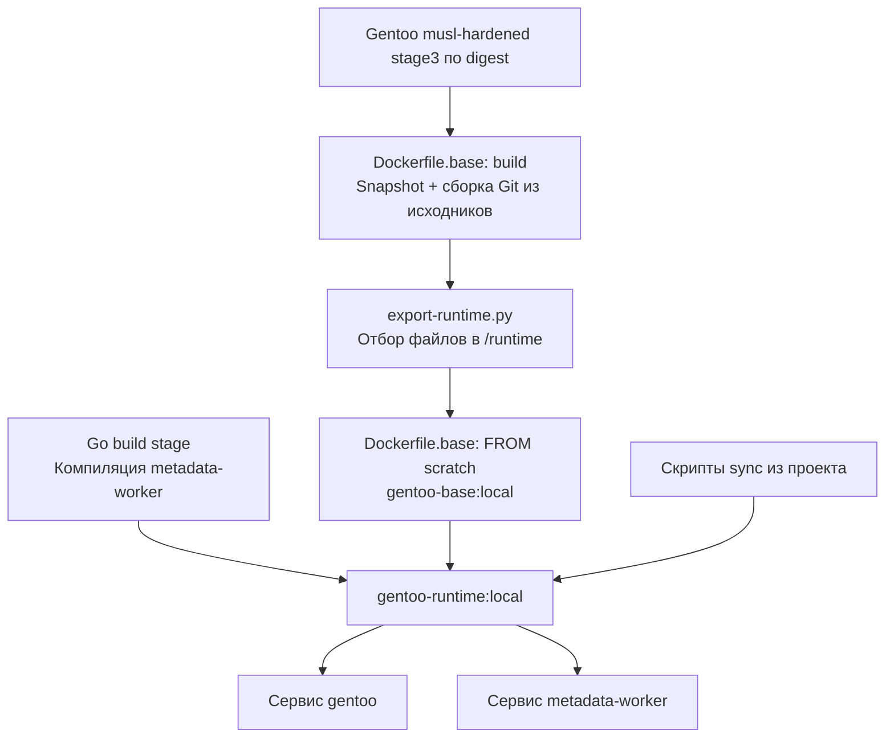

# Как устроена сборка Gentoo-образов

Команды первого запуска находятся в [README](README.md). Здесь разобраны Dockerfile, экспорт файловой системы и связь образов с работой worker и sync. Измерения и фактически выполненные проверки записаны в [acceptance.md](acceptance.md).

## Содержание

- [Какие образы мы собираем](#какие-образы-мы-собираем)
- [Зачем нужны musl, GNU и Portage](#зачем-нужны-musl-gnu-и-portage)
- [Сборка базы: Dockerfile.base](#сборка-базы-dockerfilebase)
- [Как export-runtime.py отбирает файлы](#как-export-runtimepy-отбирает-файлы)
- [Сборка приложения: Dockerfile](#сборка-приложения-dockerfile)
- [Рабочие каталоги и права](#рабочие-каталоги-и-права)
- [Команда запуска: ENTRYPOINT и CMD](#команда-запуска-entrypoint-и-cmd)
- [Что делает скрипт сборки](#что-делает-скрипт-сборки)
- [Что закреплено и как обновлять базу](#что-закреплено-и-как-обновлять-базу)
- [Что именно проверяют тесты](#что-именно-проверяют-тесты)
- [Дополнительные способы сборки и откат](#дополнительные-способы-сборки-и-откат)

## Какие образы мы собираем

Есть два Dockerfile и два итоговых образа:

| Файл | Результат | Содержимое |
|---|---|---|
| [Dockerfile.base](Dockerfile.base) | `gentoo-update-intelligence/gentoo-base:local` | musl, Portage, Python, Bash, GNU-утилиты, Git, библиотеки и сертификаты |
| [Dockerfile](Dockerfile) | `gentoo-update-intelligence/gentoo-runtime:local` | Подготовленная база, Go-бинарник worker, скрипты sync, настройки Git и рабочие каталоги |



Стадия `build` — рабочая среда сборки. Она содержит инструменты, которые не обязательно нужны при запуске. База — сохраняемый результат подготовки Gentoo-окружения. Runtime — образ приложения поверх базы. Два сервиса Compose используют один runtime, но имеют разные команды запуска, mounts и сети.

При изменении worker можно пересобрать только runtime. Подготовку базы нужно повторять при изменении stage3, snapshot, состава пакетов, настроек Git или алгоритма экспорта. Docker может использовать кеш неизменившихся стадий; отдельный Dockerfile не означает обязательную повторную компиляцию при каждом запуске скрипта.

## Зачем нужны musl, GNU и Portage

Musl — системная C-библиотека выбранной Gentoo stage3. Она используется программами и библиотеками этой базы. Мы берём готовую musl-hardened stage3, поэтому не заменяем libc внутри glibc-системы вручную.

GNU-инструменты сохраняют привычные команды и их опции для Portage и ebuild. В штатном образе остаются Bash, coreutils, findutils, grep, sed, gawk и GNU tar. BusyBox не устанавливается.

Portage нужен worker для `egencache`: эта программа вычисляет metadata выбранного ebuild с его eclass, профилем и master repositories. Portage написан на Python, а ebuild и eclass используют Bash и системные утилиты. Одного Go-бинарника для этого недостаточно. Worker не запускает установку пакетов; вызов `emerge --version` используется для чтения версии Portage.

Musl относится к среде исполнения инструментов. Профиль анализируемого пакета передаётся в запросе worker и выбирается из закреплённого checkout. Переход runtime на musl не меняет профиль анализа автоматически.

### Что даёт hardened

Профиль сборки базы — `default/linux/amd64/23.0/musl/hardened`. Он наследует no-multilib и включает настройки hardened; systemd для запуска контейнеров не нужен. Мы берём соответствующую stage3 целиком: смена одного `/etc/portage/make.profile` в обычной stage3 повлияла бы только на последующие сборки, оставив уже установленные программы прежними.

Git компилируется в этом окружении, а Python и остальные установленные компоненты приходят из hardened stage3. Экспорт в `scratch` сохраняет их бинарные файлы и библиотеки. GNU-инструменты остаются на месте; init-система в runtime не запускается.

Свойства готовых ELF проверяет `check-hardening.py`. Результаты сравнения с обычной musl-базой и ограничения проверки записаны в [acceptance.md](acceptance.md).

Этот профиль относится к C-окружению базы. Он не задаёт защиту ядра хоста и не меняет флаги отдельной сборки Go worker.

## Сборка базы: Dockerfile.base

### 1. Взять закреплённую stage3

```dockerfile
FROM gentoo/stage3:musl-hardened@sha256:44605d8ddaa109d6f60c737713fefe10fa97ea44d50f27fd17c8e25a9c678cf4 AS build
```

Stage3 даёт компилятор, Portage, Python и исходное системное окружение. Имя `build` позволяет позже копировать результат этой стадии. Digest закрепляет конкретный манифест для `linux/amd64`; изменение тега `musl-hardened` в registry не подменяет выбранную базу.

Другие архитектуры требуют отдельного выбора базовых образов и проверки. Текущая сборка и приёмка относятся к `linux/amd64`.

### 2. Получить конкретное дерево Gentoo

```dockerfile
ADD --checksum=sha256:8e4d7ed9fe4b3b256631101e9be043d6a555c66245b085d22afef2316320ce74 https://distfiles.gentoo.org/snapshots/gentoo-20261104.tar.xz /tmp/gentoo.tar.xz
ADD https://distfiles.gentoo.org/snapshots/gentoo-20261104.tar.xz.gpgsig /tmp/gentoo.tar.xz.gpgsig
```

Первый `ADD` загружает датированный архив и проверяет ожидаемый SHA-256. Второй получает отдельную подпись. Дата задаёт выбранный snapshot, checksum контролирует его байты, а последующая проверка подписи подтверждает его подлинность доверенными ключами Gentoo.

```dockerfile
RUN gemato openpgp-verify-detached --no-refresh-keys \
      --openpgp-key /usr/share/openpgp-keys/gentoo-release.asc \
      /tmp/gentoo.tar.xz.gpgsig /tmp/gentoo.tar.xz \
    && mkdir -p /var/db/repos/gentoo \
    && tar -xJf /tmp/gentoo.tar.xz --strip-components=1 -C /var/db/repos/gentoo
```

Gemato проверяет подпись ключами из закреплённой stage3. `--no-refresh-keys` отключает обновление ключей через сеть, сохраняя саму проверку. Неверная подпись или checksum останавливают сборку; перехода на другую дату или `latest` нет.

`mkdir -p` подготавливает каталог дерева. `tar -xJf` распаковывает xz-архив, а `--strip-components=1` убирает верхний каталог `gentoo-20261104/`. Ebuild, eclass и профили оказываются непосредственно в `/var/db/repos/gentoo`.

### 3. Собрать Git из исходников

```dockerfile
COPY gentoo/portage/package.use/git /etc/portage/package.use/guit-git
RUN MAKEOPTS="-j2" emerge --usepkg=n --getbinpkg=n --oneshot =dev-vcs/git-2.56.0-r1
```

`COPY` передаёт Portage [наши USE-флаги Git](portage/package.use/git). `emerge` выбирает точный atom `=dev-vcs/git-2.56.0-r1`. Параметры `--usepkg=n --getbinpkg=n` запрещают использование бинарных пакетов при этой установке; `--oneshot` не добавляет Git в набор `world`. `MAKEOPTS=-j2` ограничивает параллелизм компиляции.

| Настройки | Зачем |
|---|---|
| `curl` | Работа Git с HTTP/HTTPS |
| `safe-directory` | Сохранение проверки владельца репозитория; доверенные пути задаются в runtime отдельно |
| `-perl -rust -tk -cgi -cvs -perforce -subversion -keyring -xinetd` | Исключение необязательных интеграций и функций из сборки Git |
| `-doc -highlight -nls -test` | Отключение соответствующих опций документации, подсветки, локализации и тестов самого Git |
| `-gpg -iconv -pcre -webdav` | Отключение дополнительных возможностей Git, которые не используются нашим sync и чтением metadata |

`-gpg` относится к Git, а не к проверке подписи snapshot средствами gemato. `-test` относится к тестам пакета Git, а не к проверкам проекта.

Из исходников собирается Git и необходимые для его установки новые зависимости. Уже установленные компоненты stage3 не пересобираются целиком: Portage, Python и системные библиотеки в основном приходят из закреплённого образа stage3.

### 4. Подготовить отдельную файловую систему

```dockerfile
COPY gentoo/export-runtime.py /usr/local/lib/guit-export-runtime.py
COPY gentoo/runtime-packages /usr/local/lib/guit-runtime-packages
RUN python3 /usr/local/lib/guit-export-runtime.py /runtime --libc musl
```

Скрипт и список пакетов копируются из проекта в builder. Экспорт создаёт `/runtime` — каталог с файловой системой будущей базы. Это не подключённый volume и не каталог хоста. Экспорт не устанавливает новые пакеты: необходимые версии уже должны находиться в builder.

### 5. Сформировать итоговую базу

```dockerfile
FROM scratch
COPY --from=build /runtime/ /
ENV PATH="/usr/local/sbin:/usr/local/bin:/usr/sbin:/usr/bin:/sbin:/bin" \
    LANG=C
CMD ["/bin/sh"]
```

`scratch` начинает последнюю стадию с пустой файловой системой. `COPY --from=build` переносит только подготовленный `/runtime`, поэтому исходные слои полной stage3, дерево установки и компиляторы не наследуются конечным образом. Программы и библиотеки внутри результата по-прежнему получены из Gentoo.

`PATH` задаёт поиск исполняемых файлов, `LANG=C` — базовую локаль. `CMD` позволяет открыть shell при запуске самой базы без дополнительных аргументов. Worker и sync добавляются следующим Dockerfile.

Удаление компилятора отдельным `RUN` поверх полной stage3 не дало бы того же результата по размеру: файлы сохранились бы в нижних слоях. Здесь сокращение происходит до копирования rootfs в новую стадию.

## Как export-runtime.py отбирает файлы

Скрипт использует базу установленных пакетов и API Portage из закреплённой stage3. Он не скачивает пакеты и не вычисляет состав по именам библиотек вручную.

1. Читает [runtime-packages](runtime-packages). Это исходный список инструментов, а не полный список всех файлов образа.
2. Добавляет рекурсивные `RDEPEND` и `PDEPEND` установленных пакетов с учётом их USE. Для `||` выбирает первую ветку, в которой установлены все указанные пакеты; blockers не включает в результат. Отсутствие обязательной зависимости останавливает экспорт; обработанные пакеты повторно не обходятся.
3. Получает файлы выбранных пакетов из `CONTENTS`, сохраняет их записи в `/var/db/pkg`. Дополняет список учётными записями, сертификатами, сгенерированными symlinks и настройками окружения/загрузчика.
4. Проверяет ELF-файлы через `ldd` и добавляет найденные библиотеки. Например, `libgcc_s` нужна sandbox, хотя поставляется с GCC. Библиотека копируется без исполняемого компилятора.
5. Переносит отобранные файлы через tar с сохранением владельцев, прав, symlinks и hardlinks. Создаёт служебные каталоги, пустую стандартную конфигурацию репозиториев и `make.conf`, записывает provenance экспорта.

Из файлов пакетов исключаются `/usr/share/man/`, `/usr/share/info/` и `/usr/share/locale/`. Документация пакетов сохраняется. Для musl дополнительно переносится `/etc/ld-musl-x86_64.path`: одной библиотеки на диске недостаточно, если загрузчик не знает её каталог. Glibc-режим exporter сохранён для совместимости и сравнения, но основной Dockerfile.base явно передаёт `--libc musl`.

Symlinks usrmerge, например `/bin -> usr/bin`, сохраняются. `/dev` и `/proc` подготавливаются как каталоги; устройства и служебные mounts предоставляет Docker при запуске. Поэтому smoke-проверка инструментов выполняется в контейнере, где доступен `/dev/null`.

В образе остаются два списка:

| Файл | Что содержит |
|---|---|
| `/usr/share/gentoo-update-intelligence/runtime-packages.txt` | Версии выбранных установленных пакетов |
| `/usr/share/gentoo-update-intelligence/runtime-libraries.txt` | Найденные ELF-библиотеки |

Записи Portage описывают выбранные пакеты, но часть их документации исключена, а некоторые библиотеки добавлены отдельно. Полученная база предназначена для нашего runtime; это не полноценная stage3 для произвольной установки и сборки пакетов.

## Сборка приложения: Dockerfile

```dockerfile
ARG GENTOO_BASE_IMAGE=gentoo-update-intelligence/gentoo-base:local
```

Аргумент задаёт базу последней стадии. Объявление перед `FROM` позволяет использовать его в имени образа. По умолчанию выбирается подготовленный локальный тег. Compose передаёт одноимённую операторскую переменную как build argument; это не переменная окружения работающего worker.

### Стадия build: компиляция worker

```dockerfile
FROM golang:1.27-alpine@sha256:bff16a94c0b4b6d9642581e2a3aa81beb3edb940b2f5a3aac1d22c6a68cb7747 AS build
```

Создаёт стадию с компилятором Go на базе Alpine и даёт ей имя `build`. Digest закрепляет манифест образа Go для `linux/amd64`. Её файловая система не переносится целиком в итоговый образ.

```dockerfile
WORKDIR /src
```

Создаёт рабочий каталог `/src`. Следующие команды сборки выполняются в нём.

```dockerfile
COPY backend/go.mod backend/go.sum ./
RUN go mod download
```

Копирует описание Go-модуля и контрольные суммы, затем загружает зависимости. Пути источников `COPY` отсчитываются от контекста сборки — корня проекта. Пока эти два файла не меняются, Docker может повторно использовать слой с зависимостями при изменении исходников.

```dockerfile
COPY backend/ ./
RUN CGO_ENABLED=0 go build -trimpath -ldflags="-s -w" -o /out/metadata-worker ./cmd/metadata-worker
```

Копирует исходники backend в `/src` и собирает программу из `cmd/metadata-worker`:

- `CGO_ENABLED=0` отключает Cgo; наш worker собирается без зависимости от libc Alpine и может запускаться в Gentoo;
- `-trimpath` убирает пути среды сборки из информации, записываемой в бинарник;
- `-ldflags="-s -w"` убирает таблицу символов и DWARF-информацию отладки, уменьшая размер бинарника;
- `-o /out/metadata-worker` задаёт путь результата.

### Итоговая стадия: окружение Gentoo

```dockerfile
FROM ${GENTOO_BASE_IMAGE}
```

Начинает новую стадию на подготовленной компактной Gentoo-базе. Это последняя стадия Dockerfile, поэтому она определяет файловую систему итогового образа. Компилятор Go из стадии `build` сюда не копируется. При изменении worker установка Git и подготовка Gentoo-базы не повторяются.

```dockerfile
RUN git config --system --add safe.directory /metadata/gentoo.git \
    && git config --system --add safe.directory '/overlays/*'
```

`safe.directory` разрешает Git работать с репозиториями, принадлежащими другому пользователю: основной репозиторий записывает sync, overlays записывает backend, а worker читает их от `portage`. Эти настройки не предоставляют права записи и не отменяют read-only mounts. Кавычки вокруг `'/overlays/*'` передают шаблон Git без раскрытия оболочкой.

```dockerfile
COPY scripts/sync-gentoo-repository.sh scripts/run-gentoo-sync.sh /usr/local/lib/gentoo-update-intelligence/
```

Копирует скрипты из проекта. Первый выполняет одну загрузку, проверяет полученную ревизию и публикует Git ref. Второй запускает его в цикле, ожидая три часа после завершения каждой попытки, в том числе неуспешной.

```dockerfile
COPY --from=build /out/metadata-worker /usr/local/bin/metadata-worker
```

Копирует готовый бинарник из стадии `build`. Источник здесь находится внутри первой стадии, а не на хосте.

## Рабочие каталоги и права

```dockerfile
RUN mkdir -p /metadata-cache /var/tmp/gentoo-update-intelligence \
    && chown portage:portage /metadata-cache /var/tmp/gentoo-update-intelligence
```

Во время сборки создаёт каталоги и назначает владельцем пользователя и группу `portage`. Сам `mkdir` не создаёт volumes и не резервирует место на диске.

| Каталог | Использование в текущем Compose |
|---|---|
| `/var/tmp/gentoo-update-intelligence` | Рабочая область worker: временные checkout, настройки Portage и промежуточные результаты. |
| `/metadata-cache` | Подключённый Compose volume с сохранёнными результатами подготовки metadata в формате приложения. |

Worker при старте от root назначает владельца `/metadata-cache`, затем меняет GID и UID на `portage`. Поэтому ему нужны права записи в рабочие каталоги после снижения привилегий. Dockerfile не задаёт `USER`; sync продолжает запускаться от root с ограничениями capabilities из Compose.

Отдельный путь помогает управлять правами и видеть данные приложения. При обычных правах `1777` на `/var/tmp` пользователь `portage` также может создавать там временные каталоги самостоятельно.

Для каждого запроса worker создаёт уникальный каталог `metadata-*`. Генератор передаёт `egencache` отдельные `--config-root`, `--cache-dir` и конфигурацию репозиториев. Это позволяет обрабатывать разные закреплённые ревизии и профили без общей изменяемой конфигурации запросов. После обработки worker удаляет временный каталог; при аварийном завершении очистка не гарантирована. Постоянный кеш приложения хранится отдельно. К временному каталогу volume не подключён: удаление контейнера удаляет и его записываемый слой.

## Команда запуска: ENTRYPOINT и CMD

```dockerfile
ENTRYPOINT ["sh", "-c", "exec sh /usr/local/lib/gentoo-update-intelligence/run-gentoo-sync.sh /metadata/gentoo.git \"$GENTOO_REPOSITORY_URL\""]
```

По умолчанию образ запускает sync. Внешний `sh -c` подставляет `GENTOO_REPOSITORY_URL` из окружения контейнера. Кавычки сохраняют значение одним аргументом; `\"` экранирует их внутри JSON-строки. Внутренний `sh` исполняет скрипт с двумя аргументами: путём репозитория и URL источника. Поэтому скрипту достаточно права на чтение, исполняемый бит не требуется.

URL передаёт сервис `gentoo` из Compose. В самом Dockerfile значения по умолчанию для `GENTOO_REPOSITORY_URL` нет: при прямом запуске sync через `docker run` переменную нужно задать, иначе скрипт завершится с ошибкой отсутствующего аргумента.

`exec` заменяет внешнюю оболочку процессом, исполняющим скрипт. Это убирает лишний процесс, но само по себе не обеспечивает передачу сигналов всем дочерним процессам скрипта.

Различие инструкций Docker:

| Инструкция | Как переопределяется |
|---|---|
| `ENTRYPOINT` | Задаёт исполняемую команду. Аргументы после имени образа в `docker run` обычно добавляются к ней. Для замены используют `--entrypoint` или Compose `entrypoint`. |
| `CMD` | При отсутствии `ENTRYPOINT` задаёт команду по умолчанию; при наличии `ENTRYPOINT` задаёт её аргументы по умолчанию. Заменяется аргументами `docker run` или Compose `command`. |

Текущий `ENTRYPOINT` выбран как команда sync. В Compose worker явно заменяет его на `["/usr/local/bin/metadata-worker"]`. Существенной необходимости использовать здесь именно `ENTRYPOINT` нет: для образа с двумя ролями возможен и `CMD` с командой sync и переопределением через `command` у worker. В этом случае нужно учесть возможный унаследованный `ENTRYPOINT` базового образа.

У нашей текущей базы `ENTRYPOINT` нет, задан только `CMD ["/bin/sh"]`. Последующий `ENTRYPOINT` приложения определяет запуск sync; скрипт получает путь репозитория и URL непосредственно из его строки команды.

Текущая обёртка `sh -c` не передаёт дополнительные позиционные аргументы скрипту, поскольку в строке команды нет `"$@"`. Поэтому команду после имени образа нельзя считать способом переключения роли в текущем образе.

Правила взаимодействия инструкций: [Dockerfile reference](https://docs.docker.com/reference/dockerfile/#understand-how-cmd-and-entrypoint-interact).

## Что делает скрипт сборки

[`scripts/build-gentoo-images.sh`](../scripts/build-gentoo-images.sh) переходит в корень проекта и выполняет три шага:

1. Если `GENTOO_BASE_IMAGE` не задана в окружении shell, собирает Dockerfile.base с тегом `gentoo-base:local`. Если переменная задана, считает базу подготовленной и пропускает этот шаг.
2. Запускает выбранную базу в одноразовом контейнере без сети. Проверяет Git, Python, наличие `egencache`, сертификатов и отсутствие GCC. Запускает Bash с preload sandbox и проверяет GNU-версии `cp`, `grep`, `sed`, `find`, `tar` и `awk`. Для glibc-baseline поддерживается другой путь библиотеки sandbox.
3. Вызывает `docker compose build gentoo`. Общий блок Compose задаёт то же имя образа и сборку для `metadata-worker`, поэтому результат подходит обоим сервисам.

Скрипт собирает образы и запускает только проверочный контейнер базы. Он не запускает стек, не пересоздаёт рабочие контейнеры и не публикует образы в registry.

`POSTGRES_PASSWORD` требуется на последнем шаге: Compose разбирает весь файл, включая DSN backend и настройки PostgreSQL. Это требование конфигурации даже при сборке только `gentoo`; база PostgreSQL при этом не запускается.

Скрипт принимает глобальные параметры Compose. Например, проверки проекта запускались с `--env-file /dev/null -f compose.yaml`; эти аргументы передаются Compose, а не `docker build` базы.

Сам shell-скрипт не читает `.env` и `--env-file`. Если задать `GENTOO_BASE_IMAGE` только там, Compose может выбрать другую базу для runtime, чем та, которую подготовил и проверил скрипт. Поэтому задавайте эту переменную в окружении shell, например через `export`, для обоих этапов. Для штатной локальной сборки не переопределяйте её ни в shell, ни в настройках Compose.

## Дерево установки и репозиторий для анализа

Это разные данные с разным жизненным циклом:

| Путь | Когда появляется | Назначение |
|---|---|---|
| `/var/db/repos/gentoo` | В builder Dockerfile.base | Закреплённый snapshot для установки Git; не переносится в итоговую базу |
| `/metadata/gentoo.git` | При работе сервиса `gentoo` | Bare Git-репозиторий с историей для анализа пакетов; хранится в volume `gentoo-data` |
| `/overlays` | При загрузке overlays backend | Локальные репозитории overlays; worker читает их через отдельный volume |
| `/metadata-cache` | В runtime и при подключении volume | Сохранённые результаты подготовки metadata в формате приложения |
| `/var/tmp/gentoo-update-intelligence` | В runtime | Временные checkout и настройки конкретных запросов worker |

У bare-репозитория нет обычного рабочего дерева с распакованными файлами. Sync загружает Git-объекты, проверяет полученный commit и обновляет `refs/gentoo/published`. Отдельные refs сохраняют опубликованные commits. После завершения попытки, успешной или неуспешной, цикл ждёт три часа. Автоматической очистки опубликованной истории нет.

Backend выбирает опубликованный commit для анализа. Worker создаёт временные checkout нужных ревизий и получает профиль из них. Генератор передаёт `egencache` отдельные `--config-root`, `--cache-dir` и конфигурацию репозиториев. Его окружение ограничено `PATH`, временными `HOME` и `TMPDIR`, `LANG=C`. Поэтому удаление дерева установки из образа не лишает запрос его ebuild, eclass и профиля.

В Compose sync имеет запись в `gentoo-data` и сетевой доступ для загрузки. Worker читает `gentoo-data` и `overlay-data` только для чтения и подключён только к внутренней сети с backend. Подготовленные metadata сохраняются отдельно от временных checkout. Удаление или пересоздание контейнера без удаления volumes сохраняет репозитории и постоянный кеш; временная рабочая область может быть потеряна.

Worker начинает запуск от root, меняет владельца каталога кеша, затем GID и UID на `portage`. Compose оставляет ему `CHOWN`, `SETGID` и `SETUID` для этого старта, сбрасывая остальные capabilities и включая `no-new-privileges`. У sync capabilities сброшены полностью. Подробные параметры сервисов находятся в [compose.yaml](../compose.yaml).

## Что закреплено и как обновлять базу

| Вход | Где закреплён |
|---|---|
| Gentoo musl-hardened stage3 для amd64 | `FROM ...@sha256:...` в Dockerfile.base |
| Snapshot дерева Gentoo | Дата в обоих URL `ADD` и SHA-256 архива |
| Git | Точный atom в `emerge` и файл `portage/package.use/git` |
| Go builder для amd64 | `FROM ...@sha256:...` в Dockerfile |
| Go-зависимости | `backend/go.mod` и `backend/go.sum` |
| Исходники worker и sync | Состояние рабочего дерева проекта, переданное в контекст Docker |

Подпись snapshot проверяется ключами закреплённой stage3 без сетевого обновления. Исходные архивы пакетов проверяются Portage по Manifest выбранного дерева. Теги `gentoo-base:local` и `gentoo-runtime:local` обновляются при сборке: они не являются неизменяемыми ссылками на опубликованный артефакт.

При обновлении базы:

1. Выберите stage3 и snapshot, совместимые с нужной архитектурой и профилем сборки.
2. Обновите digest stage3. При смене snapshot одновременно измените дату обоих URL и ожидаемый SHA-256; проверка подписи остаётся включённой.
3. Проверьте выбранный atom Git, его USE и наличие исходных архивов. Если меняется состав runtime, обновите `runtime-packages`.
4. Соберите базу и runtime, выполните проверки из README. После изменения экспорта выполните также тесты выбора зависимостей.
5. Запишите результаты и измеренный размер в acceptance.md. Меняйте Go digest отдельно, если требуется обновление компилятора worker.

Digest базового образа можно получить через `docker buildx imagetools inspect gentoo/stage3:musl-hardened`; для Go — через `docker buildx imagetools inspect golang:1.27-alpine`. В списке платформ выбирайте `Name` манифеста с `Platform: linux/amd64`. Аннотация `org.opencontainers.image.base.digest` относится к базе самого опубликованного образа: для Go это Alpine, а не образ с компилятором Go.

### Повторение сборки и воспроизводимость

Повторение workflow означает запуск тех же команд с теми же файлами проекта и закреплёнными входами. Это ещё не доказательство одинакового image digest двух независимых сборок. Временные метки и другие детали сборки могут менять результат; побайтовая воспроизводимость образа не подтверждена.

Сборка с кешем может повторно использовать готовые слои, поэтому её успех не доказывает доступность всех исходников для сборки с нуля. `--no-cache` отключает кеш инструкций соответствующей сборки; `docker compose build --no-cache gentoo` не пересобирает отдельный Dockerfile.base автоматически. Базу нужно пересобрать отдельно, если требуется проверить и её установочные шаги.

Для повторения обеих сборок без кеша инструкций, из корня проекта с заданным `POSTGRES_PASSWORD`:

```sh
docker build --no-cache -f gentoo/Dockerfile.base -t gentoo-update-intelligence/gentoo-base:local .
docker compose build --no-cache gentoo
```

Здесь предполагается, что `GENTOO_BASE_IMAGE` не переопределена и runtime использует только что подготовленную локальную базу. Команды не запускают сервисы; после них нужно отдельно выполнить функциональные проверки.

Проект пока не хранит долговременную копию snapshot и distfiles. Если upstream удалит выбранный архив или проверка подписи перестанет проходить, будущая сборка остановится. Отключение проверок или подмена версии на свежую не предусмотрены. Публикация базы и runtime в registry ещё не выполнена.

## Что именно проверяют тесты

[`test-runtime.py`](test-runtime.py) использует две группы образов: проверяемый runtime и builder с закреплённым деревом. Проверяемая база не содержит этого дерева, поэтому для подготовки fixture нужен отдельный тег `gentoo-base-builder:test` стадии `build`.

Тест берёт реальные ebuild для `libei`, `libxml2`, `glibc` и Git, а также eclass и профили snapshot. Он создаёт контролируемые Git-репозитории: удаляет один ebuild новым commit для проверки исторического поиска и создаёт тестовый overlay с master Gentoo. Готовые md5-cache из snapshot не используются.

Во временном Compose-проекте проверяются:

- публикация ожидаемой ревизии sync-сервисом и общий image ID worker/sync;
- healthcheck, UID/GID worker, права записи в рабочие каталоги, read-only `/metadata` и внутренняя сеть;
- пять реальных генераций metadata, включая исторический поиск и overlay;
- SHA-256 содержимого metadata и повторное использование файлового кеша.

Если передан `--baseline-image`, тот же набор запросов выполняется на другом runtime и содержимое metadata сравнивается побайтово. Без этого параметра проверяется текущий образ без сравнительного запуска. Это сравнение результата metadata, а не воспроизводимости сборки Docker-образа.

Тест использует временные bind-каталоги, не подключает рабочие volumes и удаляет свои контейнеры и сети в конце. Fixture, логи и результаты остаются по напечатанному пути `/tmp/guit-compact-test-*`. Builder и кеш сборки могут занимать значительно больше места, чем конечный runtime; они не нужны для запуска на сервере.

[`test_export_runtime.py`](test_export_runtime.py) проверяет выбор зависимостей: ошибку при отсутствии обязательной зависимости, выбор полной альтернативной ветки, blockers, USE-условия и цикл зависимостей. Для него нужен Python с Portage, поэтому он запускается внутри базы:

```sh
docker run --rm --network none -e PYTHONDONTWRITEBYTECODE=1 \
  -v "$PWD/gentoo:/checks:ro" -w /checks --entrypoint python3 \
  gentoo-update-intelligence/gentoo-base:local test_export_runtime.py
```

[`check-hardening.py`](check-hardening.py) читает экспортированные ELF через `readelf` в стадии `build`. Итоговому runtime binutils для этого не нужны. После подготовки builder из README:

```sh
docker run --rm --network none -e PYTHONDONTWRITEBYTECODE=1 \
  -v "$PWD/gentoo:/checks:ro" --entrypoint python3 \
  gentoo-update-intelligence/gentoo-base-builder:test /checks/check-hardening.py --require-basic

docker run --rm --network none -e PYTHONDONTWRITEBYTECODE=1 \
  -v "$PWD/gentoo:/checks:ro" -w /checks --entrypoint python3 \
  gentoo-update-intelligence/gentoo-base-builder:test test_hardening.py
```

Первая команда выводит JSON с PIE, GNU_STACK, GNU_RELRO, BIND_NOW, символом stack protector и CET notes. `--require-basic` требует PIE, неисполняемый GNU_STACK и GNU_RELRO у всех выбранных программ. Вторая проверяет анализатор на двух C-файлах с явно включёнными и отключёнными защитами: файлы компилируются, но не исполняются. Наличие ELF-признаков не доказывает отсутствие уязвимостей или применение CET ядром и процессором.

Успех этих проверок не подтверждает поддержку всех исторических ebuild и произвольных overlays. Отсутствие стандартного дерева, профиля и GCC может давать предупреждения при `emerge --version` вне конкретного запроса. Полный стек с PostgreSQL и HTTP API проверяется отдельно по [руководству Compose](../docs/local-compose.md).

## Дополнительные способы сборки и откат

### Подготовить только базу

```sh
docker build -f gentoo/Dockerfile.base -t gentoo-update-intelligence/gentoo-base:local .
```

Это не добавляет worker и не запускает сервисы. После изменения только кода worker или sync при уже готовой базе достаточно `docker compose build gentoo` с заданным `POSTGRES_PASSWORD`.

### Использовать другую подготовленную базу

Задайте `GENTOO_BASE_IMAGE` в окружении shell перед запуском скрипта. Он пропустит локальную подготовку базы, проверит выбранный образ и соберёт runtime поверх него. Одного значения в `.env` или файле `--env-file` недостаточно для согласованного выбора базы скриптом и Compose. Для опубликованной базы используйте полную ссылку с registry digest. Значение должно указывать на совместимую Gentoo-базу с нужными инструментами, а не на произвольный образ musl.

Сейчас образы существуют локально. Image ID из `docker image inspect` не заменяет registry digest: наличие локального идентификатора не позволяет другой машине скачать этот образ. Для будущего запуска без компиляции на сервере потребуется опубликовать конечный runtime; публикация только базы оставит сборку worker отдельным шагом.

### Сравнение с baseline и откат

На машине проведения приёмки сохранены пары `gentoo-base:musl-baseline` / `gentoo-runtime:musl-baseline` (до hardened) и `gentoo-base:glibc-baseline` / `gentoo-runtime:glibc-baseline` в namespace `gentoo-update-intelligence`. Эти теги не опубликованы и не создаются штатным скриптом на новой машине.

Для сравнительной проверки, если baseline доступен локально:

```sh
python3 gentoo/test-runtime.py --baseline-image gentoo-update-intelligence/gentoo-runtime:musl-baseline
```

Для пересборки runtime поверх сохранённой musl-базы без hardened:

```sh
GENTOO_BASE_IMAGE=gentoo-update-intelligence/gentoo-base:musl-baseline sh scripts/build-gentoo-images.sh
```

Команда обновляет тег runtime `local`, но не пересоздаёт рабочие контейнеры. Запуск скрипта без `GENTOO_BASE_IMAGE` возвращает сборку к штатной musl-hardened-базе. Подключённые данные не меняются от одной пересборки образа; фактический запуск новых контейнеров выполняется отдельно.
